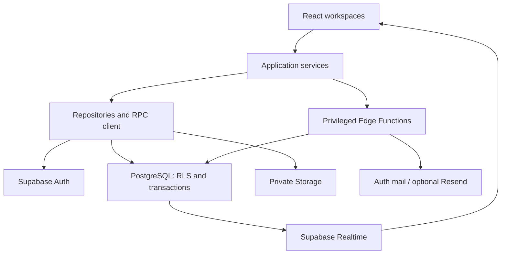
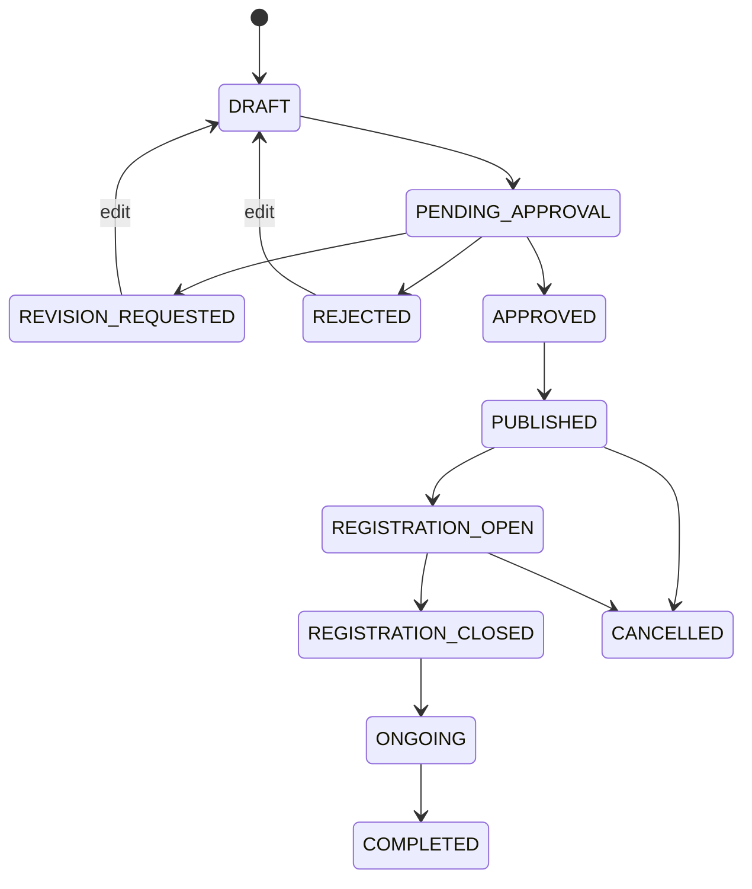

# PLANORA architecture

## Deployment model

PLANORA is a modular application with one browser deployment and Supabase backend infrastructure. It does not introduce a second backend framework or microservice fleet. PostgreSQL owns transactional invariants; Edge Functions handle privileged Auth/email integration and scheduler entry points.

## Layer boundaries

| Layer          | Location                                               | Responsibility                                                         |
| -------------- | ------------------------------------------------------ | ---------------------------------------------------------------------- |
| Presentation   | `src/features`, `src/components`, `src/app/Layout.tsx` | Pages, forms, accessible UI, responsive workspace layouts              |
| Application    | `src/services/index.ts`, query hooks                   | Named workflows, mutation orchestration, errors, cache refresh         |
| Domain         | `src/domain`, permission/state RPCs                    | Validation, role scopes, lifecycle, capacity and eligibility           |
| Data           | `src/services/repository.ts`, migrations               | Queries, typed records, atomic operations, constraints, RLS            |
| Infrastructure | `src/infrastructure`, `supabase/functions`             | Sessions, storage, email, signed URLs, scheduler auth and payment seam |

The service facade exposes authService, institutionService, userService, departmentService, clubService, eventService, approvalService, registrationService, ticketService, attendanceService, venueService, volunteerService, budgetService, certificateService, notificationService, analyticsService and reportService. UI components invoke services instead of issuing arbitrary database writes. Authoritative rules remain in SQL even when the UI also validates them.

TanStack Query owns server state. The small amount of shared client state lives in React context; Zustand is unnecessary here. React Hook Form manages form state, Zod validates event/signup boundaries, Radix supplies accessible modal behaviour, and the reusable button follows the shadcn-style Radix/CVA composition pattern. Date-fns powers the custom campus and venue calendars without a heavyweight calendar dependency.

## Tenancy and scoped authorization

An Auth user can belong to several institutions. `memberships` supplies institutional status and academic affiliation; `role_assignments` supplies multiple independent responsibilities at institution, department, club or event scope. `roles`, `permissions` and `role_permissions` define the mapping. A single global user role is never used for authorization.

`planora_private.has_permission()` checks active, email-verified membership, active institution status, role mappings and the requested record's scope. RLS filters reads. Browser roles have no direct insert/update/delete grants on application operational tables; public RPCs perform explicit authorization before writing. Composite foreign keys prevent cross-tenant event/club/venue/member relationships.

Platform administration is separate. It can create/suspend tenants, configure plans and global categories, view aggregate usage and resolve support requests. It cannot automatically read student records. An explicitly assigned institution owner/admin role is needed for those records.

## Core transactions

- Registration locks its event row, verifies eligibility/deadline/custom answers/team size, processes expired invitations, counts confirmed and invited seats, and inserts a unique registration. Duplicate event/user pairs are constrained.
- Cancellation/acceptance/manual review use the same event-first locking order. Waitlist selection uses `(created_at, id)` FIFO order. Invitations reserve seats until accepted or expired; the scheduler and user actions use the same helper.
- Each team member consents and registers independently using an opaque join code. `team_max` is enforced at registration. `team_min` confirmed membership is enforced before check-in. Seats are per participant; this implementation does not promise all-or-nothing group waitlist promotion.
- Final approval locks the venue row and rejects exact interval overlap before confirming the booking. Resource allocation locks the resource and counts overlapping allocations. Approvals revalidate existing allocations after rescheduling.
- QR issuance rotates a random token, stores its SHA-256 hash in a private schema and returns the raw token only to its registration owner. Check-in locks the registration and returns the existing attendance result on repeat scans. Attendance has a unique registration constraint.
- Approval decisions are tied to the event's content-version timestamp. Editing/rescheduling changes the version and returns the event to draft. Required independent reviewers cannot approve their own proposal or double-count one reviewer.

## Lifecycle

Cancellation is also supported from other nonterminal states; rescheduling returns eligible pre-event states to draft. Institutions can configure an explicitly optional approval policy; such submissions auto-approve through the same venue and resource checks. Published state is never assigned by a browser table update.

## UI and product design

The visual identity uses forest green, warm off-white, restrained lime accents and an original PLANORA monogram. Student discovery emphasises the experience, date and registration action. Organiser interfaces emphasise tasks, arrivals, readiness and required decisions. Empty states describe the absence of real data rather than inserting example metrics.

Design principles studied from primary product materials include Luma's low-friction registration and explicit pending/waitlist status, and Eventbrite's event-specific check-in responsibilities and duplicate ticket feedback. The campus-specific integration—approval, venues, finance, role scopes and event passport—is independently structured.

References:

- https://help.luma.com/p/event-registration-process
- https://help.luma.com/p/waitlist
- https://www.eventbrite.com/help/en-us/articles/509534/beheer-van-rollen-en-machtigingen/
- https://www.eventbrite.co.uk/help/en-gb/articles/741083/how-to-check-in-attendees-at-the-event-with-eventbrite-organizer/
- https://supabase.com/docs/guides/database/postgres/row-level-security
- https://supabase.com/docs/guides/database/functions
- https://supabase.com/docs/guides/database/testing

## Scaling and extension seams

Indexes cover tenant/status/start discovery, full-text search, membership/role lookups, registration queue order, venue time ranges and notifications. Event discovery is paginated. Counts/reports use SQL aggregates over authorized rows. Optional spreadsheet, PDF, scanner and chart code is loaded separately from initial navigation where practical.

Directory and operational lists have documented bounded result sizes. A large institution should add server cursor pagination to those lists and perform load tests before exceeding those bounds. PGlite tests validate transaction logic but do not establish multi-connection contention performance or cloud capacity.

The payment provider interface deliberately throws until implemented. Subscription entitlements currently control event creation, registration availability and active-event allowances; billing is separate. Future payment capture, refunds and billing must include provider webhooks, idempotency and reconciliation before paid events are enabled.
